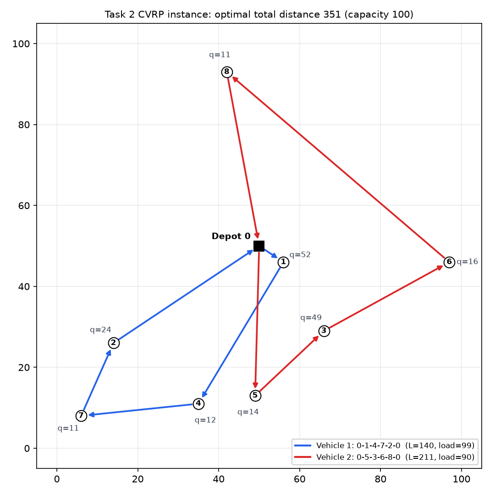
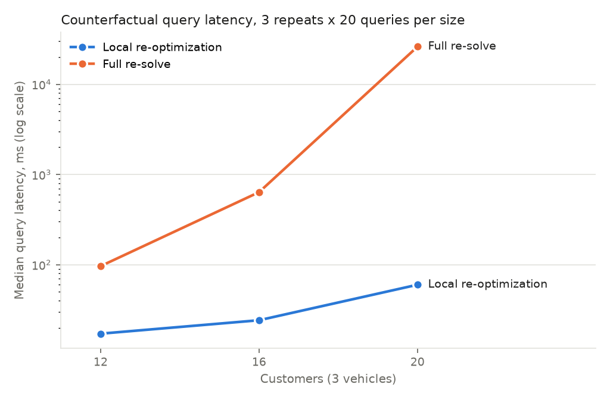

# Task 2: From Solution to Trust: Explanation, Counterfactuals, and Feedback Localization

Everything here runs on a laptop CPU (Apple M2 Pro): Gurobi 13.0.3 with its size-limited pip license, plus `qwen3.8-max` through DashScope's OpenAI-compatible API for the two LLM steps. Detailed numbers: [`results/task2_results.md`](results/task2_results.md). Design decisions: [`DECISIONS.md`](DECISIONS.md).

> **After the 2026-10 audit** a second protocol, task2_v2, fixes three defects: attribution reported wrong objective values for alternatives under soft constraints (it relabelled and re-oriented the routes), the counterfactual timing gave the local method its model set-up for free, and the localization confidence rule counted disagreements the user cannot resolve. Sections 1 to 7 describe task2_v1 exactly as it was frozen and evaluated; its files and `results/` are unchanged. Section 8 reports task2_v2 beside it. Four defects found in v2 after its runs are fixed in task2_v2.1 (section 8.5); re-computed without the LLM on every state and sample set the v2 evaluation recorded, v2.1 gives v2's results exactly. Section 9 reports task2_v3: a new set of 10 test cases designed for both this evaluation and Task 3's ablation (the v1 cases could not separate Task 3's mechanisms).

> **Current test cases:** section 9 (task2_v3, the 10 cases Task 3 v3/v3.1 and Task 4 v3/v3.1 use). Sections 1 to 7 describe task2_v1 and its cases T1-T10.

## 1. Instance

1 depot (node 0) at (50, 50), 8 customers, 2 identical vehicles with capacity **Q = 100**, no time windows. Distances are `c_ij = floor(euclid(i, j) + 0.5)` (symmetric integers). Objective: minimize total travel distance. Each vehicle leaves the depot exactly once (both are used); every customer is served once; a vehicle's load may not exceed Q. Machine-readable spec: [`instance/cvrp_instance.json`](instance/cvrp_instance.json) (SHA-256 `1a9e58dc…cab6`, frozen); human-readable: [`instance/instance.md`](instance/instance.md).

| Node | 0 (depot) | 1 | 2 | 3 | 4 | 5 | 6 | 7 | 8 |
|---|---|---|---|---|---|---|---|---|---|
| (x, y) | (50, 50) | (56, 46) | (14, 26) | (66, 29) | (35, 11) | (49, 13) | (97, 46) | (6, 8) | (42, 93) |
| Demand | 0 | 52 | 24 | 49 | 12 | 14 | 16 | 11 | 11 |



**Optimum: 351**, unique up to vehicle relabeling and route reversal (second best 356). Vehicle 1: 0-1-4-7-2-0 (length 140, load 99); vehicle 2: 0-5-3-6-8-0 (length 211, load 90). Gurobi and an independent brute-force enumerator (all 282,240 labeled, directed solutions) agree on value and routes.

The instance was drawn with a fixed seed (20261022) and is the first of 874 candidates that meets five design goals, all checked by brute force: D1 unique optimum; D2 some customer pair exceeds Q together (1 + 3 = 101); D3 dropping the capacity constraint changes the optimal grouping (294 vs 351); D4 both loads ≥ 0.8Q (99, 90); D5 route-length ratio ≥ 1.2 (1.51). The capacity is tight: only 14 customer groupings are feasible.

## 2. Model and IDs

Three-index MIP ([`cvrp/model.py`](cvrp/model.py)): `x[k,i,j]` (vehicle k drives i→j), `y[k,i]` (customer i on vehicle k), cumulative load `u[i]`, indicators `L[k]` (route length), `W[k]` (load), `S[k]` (stops), `A[i]` (km driven before reaching customer i), and auxiliaries `balance = |L1−L2|`, `makespan = max(L1, L2)`, `load_balance = |W1−W2|`. 185 variables, 176 constraints.

| Constraint ID | Meaning | Category |
|---|---|---|
| `visit[i]` | customer i served by exactly one vehicle | general business |
| `cap[k]` | load of vehicle k ≤ Q | specific business |
| `depot_out[k]` | vehicle k leaves the depot once | general business |
| `flow_out[k,i]`, `flow_in[k,i]` | degree = assignment | structural |
| `mtz[i,j]` | load-based subtour elimination; `u ≤ Σq`, so it never implies capacity and IIS lands on `cap[k]` | structural |
| `arr[i,j]`, `def_*` | arrival-mileage lower bounds, indicator definitions | structural |

Canonical IDs equal Gurobi names ([`cvrp/ids.py`](cvrp/ids.py)). Reported metrics are always recomputed from the routes, never read from solver variables (`A[i]` only has lower bounds).

**Symmetry.** The vehicles are identical and distances symmetric, so "vehicle 1" and "5 before 3" are not well defined by themselves. Decisions under attribution are therefore label- and direction-free: `ADJ(i,j)` (visited consecutively), `SAME(i,j)`, `SEP(i,j)`. Counterfactual queries (`FIX_ARC`, `MOVE`, `SWAP`, `FORCE/FORBID_ADJ`, `FORCE_SAME/SEP`, `APPLY_MODIFICATIONS`) use a **single anchor**: the smallest customer not involved in the query stays on its current vehicle, which defines "vehicle 1" as "the route holding the anchor". Change sets are (customers that changed vehicle, undirected edges added/removed); a pure route reversal only sets a flag.

**Modifications** (the output format of localization and, later, of TPO), see [`schemas/modification.schema.json`](schemas/modification.schema.json):

```json
{"op": "add_soft_constraint", "target": "L[2]", "sense": "<=", "rhs": 180, "penalty": 10}
{"op": "set_objective_weight", "term": "balance", "weight": 0.8}
{"op": "modify_data", "field": "demand[4]", "value": 20}
```

Soft-constraint targets: `L[k] W[k] S[k] A[i] e[i,j] same[i,j] sep[i,j] balance makespan load_balance sum_arrival` (the last five and `A[i]` accept only `<=`, because they are bounded from below only). Objective = total distance + Σ weight × term + Σ penalty × violation.

## 3. Components

All three are JSON-in / JSON-out functions over `state = {instance, modifications, solution}`; output schemas are in [`schemas/`](schemas/).

**Decision attribution** ([`components/attribution.py`](components/attribution.py)). Add the constraint that forbids the decision and re-solve. If infeasible, compute the IIS; the attribution set is its specific business constraints (`cap[k]`), and the rest of the IIS is listed by category. If feasible, the decision is preferred by the objective: report the objective increase, the per-term breakdown, and the undirected edges that differ between the current plan and the best plan without the decision (Σ added − Σ removed = increase); those edges are the attribution set. Also reported: capacity slack of each vehicle, and LP-relaxation duals `Pi` / reduced costs `RC` of the related constraints and variables. The LLM writes an English explanation from this JSON only; a checker requires every number in the text to appear in the JSON and every customer, vehicle and constraint to exist. One regeneration is allowed; then a template is used and the case counts as a failure.

**Counterfactual explanation** ([`components/counterfactual.py`](components/counterfactual.py)). The local method keeps one model per state in memory. For each query it adds the query constraints and the anchor, warm-starts from the current solution, and re-optimizes a growing neighbourhood: L0 lets only the query's customers change vehicle (both routes may be re-sequenced), L1 also frees each one's 2 nearest customers, L2 frees everyone. It escalates only on infeasibility, so "infeasible" is only reported after L2. Everything added is removed afterwards. The control method (`method="full"`) builds a fresh model and solves from scratch with the same anchor. Output: feasibility, objective and total distance, deltas, change set, reversal flag, all indicator changes, level reached, latency.

**Feedback localization** ([`components/localization.py`](components/localization.py)). The LLM receives the instance, the current plan with all indicators, and the complaint, and returns object / aspect / direction / modification type / threshold / corrected value / ambiguity / clarifying question as JSON (5 samples at temperature 0.7). The program validates each sample against a schema, maps (object, aspect) to a canonical target ID (`L[2]`, `A[6]`, `e[6,8]`, `demand[7]`, `balance`, …) and checks that it exists. Confidence is rule-based, not self-reported: **high** if at least 4 of 5 samples agree on (target, modification type), at least 3 are not flagged ambiguous, and at most 1 is invalid; otherwise **low**. A low result returns only a clarifying question and no critique, so nothing reaches TPO. A high result returns the structured critique, with text from a template and no further LLM call. `localize(state, complaint, clarification=...)` re-localizes with the user's answer.

## 4. Test cases

10 cases ([`cases/test_cases.json`](cases/test_cases.json), frozen; review: [`cases/CASE_REVIEW.md`](cases/CASE_REVIEW.md)). Each case has a solution, an English user complaint, a "why" decision, a "what if" query, ground truth for all three components, a programmatic checker for "complaint resolved" (used by Task 3), a simulated clarification answer, a reference modification that provably resolves the complaint, and the allowed data corrections. Attribution and counterfactual ground truth come from the brute-force enumerator and are cross-checked with Gurobi; localization ground truth is hand-labelled. [`cases/verify_cases.py`](cases/verify_cases.py) checks all of this, plus that every complaint fails its checker initially and cannot be removed by a free route reversal.

Coverage: attribution 2 capacity-forced / 8 objective-preferred; counterfactual 7 feasible-and-worse / 1 unchanged (a reversal) / 2 infeasible by capacity; 7 clear / 3 ambiguous complaints; reference fixes 6 soft constraints / 2 objective weights / 2 data corrections; complaints about vehicles, customers, data and the whole plan. One case (T9) uses a variant day (customer 3 orders 54), because under the base data only one decision, `SEP(1,3)`, is forced by capacity. Prompts and rules were developed only on 5 separate dev cases ([`cases/dev_cases.json`](cases/dev_cases.json)).

## 5. Results

One-shot run on 2026-10-23 under the frozen protocol ([`protocol.json`](protocol.json)); LLM parts were run 3 times (mean ± sample std), deterministic parts once; every component output passed its JSON Schema. Full tables: [`results/task2_results.md`](results/task2_results.md); raw artifacts: `results/raw/`; [`recompute.py`](recompute.py) reproduces every number offline.

**Decision attribution (10 cases).**

| Metric | Value |
|---|---|
| Returned set contains the ground truth | 10/10 |
| Precision / recall (per-case mean and pooled) | 1.00 / 1.00 |
| Constraint part (2 capacity-forced cases, IIS → `cap[1]`, `cap[2]`) | P 1.00, R 1.00 |
| Variable part (8 objective-preferred cases, 60 edges) | P 1.00, R 1.00 |
| LLM explanation passes number/entity checks | 100% ± 0 (all on the first attempt, no template fallback) |

**Counterfactual explanation.**

| | 10 test queries | 120 supplementary queries (all MOVE + FIX_ARC on the optimum) |
|---|---|---|
| Feasibility, local vs full | 10/10 | 120/120 |
| Objective within 1%, local vs full | 7/8 | 87/101 (86.1%) |
| Change set, local vs full | 6/8 | 83/101 (82.2%) |
| Full re-solve vs exhaustive ground truth | 100% on all three | 100% on all three |
| Latency, median / mean / p95 ms, local | 17.1 / 26.5 / 77.1 | 3.6 / 7.2 / 28.7 |
| Latency, median / mean / p95 ms, full | 45.7 / 40.0 / 68.0 | 7.6 / 14.0 / 46.7 |
| Local stopped at L0 / L1 / L2 / infeasible | 4 / 0 / 4 / 2 | 24 / 35 / 42 / 19 |

Latency includes model setup (for the local method: adding and removing the query constraints; its resident model is built once). The local method never reported "infeasible" before L2. Its disagreements are all cases where a smaller neighbourhood was feasible but worse, so it stopped there (see Limitations 2).

**Feedback localization (3 runs).**

| Metric | First pass | With the clarification answer |
|---|---|---|
| Accuracy (majority target in the ground-truth list) | 90.0% ± 0 | 100% ± 0 |
| Accuracy when predicted high (7 per run) | 100% ± 0 | 100% (10 high per run) |
| Accuracy when predicted low (3 per run) | 66.7% ± 0 | n/a |
| Clarifying-question rate | 30% | 0% |
| Invalid samples | 0% | 0% |
| Modification type correct | 100% | |

Expected vs predicted confidence matched exactly in every run: the 7 clear complaints were high, the 3 ambiguous ones were low, and no low result carried a critique. The one wrong majority target is T8 ("The drivers are unhappy with how the work is split"). It was read as distance balance while the user meant loads; because the result was low-confidence, it went to clarification instead of TPO, and the clarified pass got it right.

**Scale-up (optional stage 7).** Random instances with 12, 16 and 20 customers and 3 vehicles (fixed seed, capacity at 85% average load; up to 1,340 variables, inside the license limit), 20 random MOVE / FIX_ARC queries per size, 3 repeats per method, 300 s cap per solve (never reached). Separate code in [`scale/`](scale/); with 3 vehicles each vehicle gets its own anchor so that labels are well defined. Nothing here fed back into the main experiment.



| Customers | Local, median / mean / p95 ms | Full, median / mean / p95 ms | Objective within 1% | Local worse than full (median / max gap) |
|---|---|---|---|---|
| 12 | 17 / 78 / 256 | 96 / 132 / 284 | 17/20 | 3 queries (1.8% / 2.0%) |
| 16 | 24 / 220 / 1,161 | 637 / 1,120 / 2,817 | 7/20 | 13 queries (2.3% / 6.8%) |
| 20 | 60 / 22,919 / 57,925 | 26,103 / 32,966 / 62,307 | 16/20 | 4 queries (3.1% / 9.1%) |

The median gap grows from 6× to about 435× as full re-solves become expensive. The mean and p95 stay close to each other because a query that has to escalate to L2 is a full solve with extra steps.

## 6. Limitations

1. **Scale.** With 9 nodes a full re-solve takes tens of milliseconds, so the local method's lower median (17 vs 46 ms on the test queries) has no practical value. The scale-up run shows where it starts to matter: at 20 customers and 3 vehicles the median query drops from 26 s to 60 ms. That speed comes from searching a small neighbourhood and stopping at the first feasible level. The price is answer quality: the local answer was worse than the full re-solve in 3, 13 and 4 of 20 queries at 12, 16 and 20 customers (up to 9.1% worse), and any query that escalates to L2 costs about as much as a full solve.
2. **The escalation rule trades quality for speed.** As specified, the local method widens its neighbourhood only when the current level is infeasible. A soft-constraint or weight query never makes L0 infeasible, so the local method can return a much worse answer: for T1 (vehicle 2 ≤ 180 km) it kept the current plan and paid the penalty (objective 661, including the penalty) while the full re-solve found 368. On the supplementary queries all 14 objective disagreements stop at L1, 4.6% worse on median (at most 7.9%). Escalating when the penalty term is positive, or when the objective gap to a cheap bound is large, would fix this. The rule was frozen before evaluation and was not changed afterwards.
3. **LP duals and reduced costs are reference only.** The LP relaxation of the three-index model is weak (bound 250 vs optimum 351; the capacity duals are 0), so they play no role in the attribution sets.
4. **IIS is not unique.** For both capacity-forced cases we checked by brute force that dropping either `cap[k]` restores feasibility, so both capacity constraints belong to every IIS and the attribution set does not depend on which IIS Gurobi returns.
5. **The objective-preferred half of attribution is close to definitional, and the 10/10 has a narrow scope.** The component and the ground truth both define the attribution set as the edge difference to the best plan without the decision, so 100% mainly confirms a correct implementation. All 10 cases attribute a decision of an optimal plan of the unmodified model, where vehicle labels and route direction do not change the objective; on plans under soft constraints task2_v1's reported objective of the alternative was wrong in 149 of 885 decisions (section 8). The informative parts are the IIS side and the explanation checks. The explanation checker catches invented numbers and entities but not semantic errors: during dev tuning the LLM once described the alternative plan's legs as the current plan's, which the checker cannot detect. That was fixed by renaming fields and clarifying the prompt.
6. **Ground truth and sample size.** Attribution and counterfactual ground truth come from exhaustive enumeration and were reviewed by hand; localization ground truth is hand-labelled. With 10 cases, every rate has a wide uncertainty (one case = 10 points). The 3 LLM runs gave identical majority results, so the reported std of 0 reflects stable outputs at fixed seeds, not a measured variance.
7. **LLM version.** `qwen3.8-max` is an alias without a fixed snapshot; all calls were made on 2026-10-23 with `enable_thinking=false`.
8. **Instance-specific constraints on the cases.** Only one decision is forced by capacity under the base data, so case T9 uses a variant day (customer 3 orders 54). Total waiting time and longest route have almost no room to improve here (minimum 573 vs 588, and 207 vs 211), so the two objective-weight cases use distance balance (weight 0.8) and load balance (weight 4). Several reference fixes and counterfactual answers land on the same runner-up plan (368: `[1,7,2,8] / [4,5,3,6]`).
9. **Vehicle identity is a convention.** "Vehicle 1" in a re-optimized plan is the route that holds the anchor customer. That is why "move customer 7 to vehicle 2" changes the vehicle of 6 customers.

## 7. Reproduce

```bash
python -m pytest -q                         # model vs brute force, cases, components
python -m instance.report_instance          # instance cross-check, figure, oracle report
python -m cases.verify_cases                # test-case acceptance
source ~/.dashscope_env                     # DASHSCOPE_API_KEY, DASHSCOPE_BASE_URL
python evaluate.py --split test             # one-shot evaluation (refuses to overwrite results/raw)
python recompute.py                         # recompute every metric offline from results/raw
python report.py                            # results/task2_results.md
python final_checks.py                      # acceptance checklist -> results/acceptance.json
python -m scale.run_scale && python -m scale.summarize   # optional scale-up latency run (about 1 hour)
```

## 8. Protocol task2_v2 (after the 2026-10 audit)

New code lives in [`v2/`](v2/) (outside every file pattern that task2_v1, Task 3 and Task 4 hash), results in [`results_v2/task2_v2_results.md`](results_v2/task2_v2_results.md), tests in `tests/test_v2_*.py`. [`v2/protocol_v2.json`](v2/protocol_v2.json) was frozen before any LLM call. LLM parts ran on 2026-10-27: 330 requests, all answered on the first attempt by `qwen3.8-max`; seeds come from new component names, so every sample is new.

### 8.1 Decision attribution (audit F1)

**The defect.** task2_v1 re-solved the model with the decision forbidden and no anchor, then put the alternative into canonical form (route with customer 1 = vehicle 1, smaller end first). With a label-dependent (`L[2] <= 180`) or direction-dependent (`A[i] <= 70`) term that rewrite changes the objective, so the reported alternative objective was not the one the solver found. Example: the runner-up plan (368) under `L[2] <= 180` with penalty 100, decision `ADJ(3,6)`: v1 reports 4,663, the alternative costs 369. In Task 3's run this put 18 wrong numbers into prompts.

**The fix** ([`v2/attribution.py`](v2/attribution.py)). (1) A single anchor relative to the current plan, so "vehicle k" keeps its meaning. Under a label-dependent term the anchor changes the feasible set, so it is the first customer (uninvolved customers first, the decision's own customers last) under which the current plan is itself optimal; the plan and the alternative are then compared on the same feasible set. (2) No relabelling; a route is reversed only if the objective stays the same, and the alternative's objective is checked against the solver's. (3) If forbidding the decision is cheaper (the plan is optimal under no single-customer anchor), the conclusion is `cheaper_without`, not `objective_preferred`. For capacity-forced decisions the IIS is taken without the anchor (feasibility does not depend on labels), as in v1.

| | v1 | v2 |
|---|---|---|
| 10 test cases: set contains the ground truth / pooled P and R | 10/10, 1.00 / 1.00 | 10/10, 1.00 / 1.00 |
| LLM explanation passes the number and entity checks (3 runs) | 100% | 100% |
| 24 plans with soft constraints, weights or corrected data (10 reference-fix plans and 14 Task 3 loop states), every ADJ / SAME / SEP decision (912): capacity-forced conclusions correct | 27/27 | 27/27 |
| ... objective of the alternative equals brute force | 736/885 (83.2%; largest error 46,500) | 885/885 |
| ... edge set equals brute force | 885/885 | 885/885 |
| ... decisions where a cheaper plan exists without them | 96 (labels free), all called objective-preferred | 0 under the anchor v2 chose; this follows from the anchor claim (the plan is optimal under it), which brute force confirms on 912/912, so it is not separate evidence |

Ground truth is the brute-force oracle (no Gurobi): labels free for v1, which is what v1 solves, and under the anchor v2 chose for v2. The edge sets were always right because edges do not depend on vehicle labels; the error was in the number shown with them.

### 8.2 Counterfactual (audit F4)

task2_v1 timed the local method on a resident model built before the timed call and the full re-solve with the model built inside it. Here each method runs both ways: *warm* (one resident model per method and state, built outside the timed call) and *cold* (built inside every call). Methods: local with the frozen escalation rule, local with Task 3's rule (also escalate on a remaining soft violation, an unchanged plan or a data change; the probe the TPO loop uses), and full (every customer free, no MIP start, resident model reset before each solve). Median latency, ms (20 repeats per query):

| Queries | local v1 warm / cold | local v2 warm / cold | full warm / cold | Objective within 1% of exhaustive: local v1 / local v2 / full |
|---|---|---|---|---|
| 10 test-case queries | 12.8 / 13.4 | 14.9 / 16.3 | 35.6 / 37.9 | 7/8 / 8/8 / 8/8 |
| 120 supplementary MOVE and FIX_ARC | 2.8 / 4.3 | 2.8 / 4.2 | 4.9 / 6.3 | 87/101 / 87/101 / 101/101 |

On 9 nodes building the model costs 1 to 2 ms, so equal set-up leaves the comparison almost where it was (v1 reported 17.1 vs 45.7 ms). Task 3's escalation rule fixes T1 (it no longer stops at L0 and pays the penalty); it does nothing for the 14 supplementary queries that stop at L1 with a worse feasible plan, because those are hard-constraint queries with no soft violation to detect.

### 8.3 Feedback localization (audit F5, Task 4's T7)

task2_v1 judged confidence by agreement on (target, modification type) and ignored direction and limit. That is wrong both ways: in Task 4's end-to-end run all five samples for T7 agreed on `balance <= 50` but split 3:2 between a soft constraint and a weight, so the complaint was judged low confidence, the user was asked a question that could not settle a choice internal to the system, and the complaint stopped. [`v2/localization.py`](v2/localization.py) counts agreement on what the user means and can answer (target, direction, threshold, corrected value), takes the modification type by majority among the agreeing samples, and asks about the first point of disagreement in the user's words (never internal IDs, never the modification type).

- **Same samples, new rule:** on the 60 decisions of v1's three runs (first pass and clarified pass) the v2 rule decides exactly as v1; on Task 4's T7 both passes become high confidence (`balance`, soft constraint, limit 50).
- **Fresh run, 3 x 10 complaints:** identical to v1 on every metric: first-pass accuracy 90%, high-confidence 7 of 10 per run and all correct, the 3 ambiguous complaints (T2, T6, T8) asked every time, 100% after the clarification answer, modification type 100%, no low-confidence result carried a critique. All 9 questions were the LLM's own (the samples agreed on the meaning but flagged the complaint as ambiguous), for example "Do you mean vehicle 1's load (99 units), its route length (140 km), or its number of stops (4) is too high?".

### 8.4 Known issues found after the runs

An independent review of the v2 code after the LLM runs found four defects. None of them occurred in any state the reported runs produced: every one of the 2,677 attribution items that reached a prompt in Task 3 and Task 4 v2, and the 912 evaluated here, has an anchor claim and conclusion that brute force confirms with an exact tolerance; no Task 2 or Task 4 high-confidence critique had a modification type that is impossible for its target. They are fixed in task2_v2.1 (8.5); the frozen v2 files that produced these results are unchanged.

1. **Anchor tolerance** (`v2/attribution.py`, `consistent_anchor`): the current plan was accepted as optimal under an anchor if the solver's optimum was within 0.1% of it. With fractional weights a real gap can be smaller: for weight 0.8 on `balance` plus `W[1] <= 90` (penalty 1), plan `[[1,7,2,8],[4,5,3,6]]` (412.8) and `SAME(1,2)`, anchor 3 has optimum 412.4, is accepted, and the decision is reported `cheaper_without`; anchor 5 makes the plan optimal and gives objective-preferred. The comparison should use the exact objective of the solver's plan.
2. **Infeasible current plan** (`v2/attribution.py`): a plan that violates capacity on the model's data is attributed anyway, and its (impossible) objective passes the anchor test trivially. It should be rejected or reported as infeasible.
3. **Modification type** (`v2/localization.py`): the type is the majority among agreeing samples without checking that it is valid for the target, so a 3:2 split could yield `set_objective_weight` on `L[2]`, which the modification schema forbids; a 2:2 tie is broken by sample order. v1's rule would have returned low confidence there.
4. **Limits that do not apply** (`v2/localization.py`): threshold and corrected value count towards agreement even for forbid / require / correct directions, so `null` against `0` on an edge target lowers confidence and produces an odd question.

Also fixed in the (unfrozen) report script: a missing alternative objective would have counted as correct; re-running the report after the fix gives identical results.

### 8.5 Protocol task2_v2.1: the four fixes, checked without the LLM

New package [`v21/`](v21/): it imports `v2/` and replaces only the functions that change; `v2/` and `results_v2/` are untouched, and `v2/protocol_v2.json` still matches (Task 3 and Task 4 verify it at start-up). [`v21/protocol_v21.json`](v21/protocol_v21.json) (35 file hashes, v2's included) was frozen before the re-check.

| Defect (8.4) | task2_v2.1 |
|---|---|
| 1. Anchor tolerance | An anchor is accepted only if the solver's plan under it costs at least the current plan, both by `canon.objective` (tolerance 1e-6; the model solves with MIPGap 0). In the review example v2 called 16 of the plan's 38 decisions `cheaper_without`; v2.1 calls none, and brute force confirms its anchor claim and alternative for all 38. |
| 2. Infeasible current plan | A plan over capacity on the data in force gets the conclusion `current_plan_infeasible` with the overloaded routes, and no anchor, alternative or LLM explanation (a template says why). A plan that is not a plan of the instance is an error. |
| 3. Modification type | The majority among the agreeing samples whose type the target admits (`modify_data` for demand, location and capacity; soft constraint or weight for the four objective terms; soft constraint for every other target), ties by sample order as before; if none is admissible, the target's first admissible type. The type is still never a reason to ask. |
| 4. Limits that do not apply | Agreement counts the corrected value for a data target, the threshold for `decrease` / `increase` on any other target, and no limit for `forbid` / `require`. The critique carries the most common value among the agreeing samples, which is v2's value whenever v2 was confident. |

Tests: [`tests/test_v21.py`](tests/test_v21.py), 17 (162 in Task 2, all pass); one of them checks that the re-check's comparison does see a real change.

**Re-check** ([`results_v21/recheck.md`](results_v21/recheck.md), `python -m v21.recheck`, no LLM): v2.1 re-computed on every state and sample set the v2 evaluation recorded and compared with v2's output field by field.

| Records | Checked | v2.1 differs from v2 |
|---|---:|---:|
| Attribution, the 10 test cases | 10 | 0 |
| Attribution, the inputs of the 30 explanations | 10 | 0 |
| Attribution, decisions on plans with soft constraints and weights (8.1) | 912 | 0 |
| Localization, the v1 run's samples | 60 | 0 |
| Localization, the v2 run's samples | 60 | 0 |

So every number in 8.1 to 8.3 also holds for v2.1. Task 3 and Task 4 re-checked their own v2 records the same way (2,502 and 175 attribution items, 39 and 35 sample sets, 27 service iterations): no difference either. Nothing changed because none of the recorded inputs reaches the defects: every recorded plan was committed by the solver on the data in force, so it is feasible and optimal under some anchor, which the exact test also finds first; every recorded sample gives a limit only where one applies (data targets `correct` with a value, pairs `forbid` / `require` without one, quantities `decrease`); and every confident majority already had an admissible type. The other side of this result: the evaluations never exercised these paths, so the constructed examples in `tests/test_v21.py` are the only evidence for the fixes.

### 8.6 Reproduce

```bash
python -m pytest -q tests/test_v2_attribution.py tests/test_v2_localization.py tests/test_v21.py
python -m v2.evaluate --part attribution            # also counterfactual, localization_rescore (no LLM)
source ~/.dashscope_env
python -m v2.evaluate --part explanation            # also localization; refuses unless v2/protocol_v2.json matches
python -m v2.report                                 # results_v2/task2_v2_results.{json,md}
python -m v21.freeze && python -m v21.recheck       # task2_v2.1: refuses to overwrite; results_v21/
```

## 9. Protocol task2_v3: test cases re-designed for Task 3 (2026-10-27)

Design: [`../../DESIGN_V3.md`](../../DESIGN_V3.md). The task asks for one set of 10 test cases used by both Task 2 and Task 3. The v1 cases served Task 2 but not Task 3: every complaint could be met by one soft constraint at the user's limit, and the limits of the ambiguous complaints were given only in the clarification answer. task2_v3 keeps every requirement of Task 2 (a solution, a user-style complaint or question, ground truth for localization, attribution and counterfactual) and adds what Task 3 needs.

- **Cases** ([`v3/cases.py`](v3/cases.py), [`v3/cases/cases.md`](v3/cases/cases.md)): 2 control, 3 ambiguity, 5 side (a request plus a second condition the modification language cannot express directly); 10 development cases built by the same recipe for Task 3's pilot. Every requirement of the user is a condition ([`v3/conditions.py`](v3/conditions.py)) stated in the complaint or in the user's explanation. The builder asserts by brute force: the plan complained about fails; a compliant plan exists (shortest distance recorded); the reference fix (at most 4 modifications, the commit's anchor and tie orientation) resolves the case in every optimum; the stratum's property (control: direct encoding resolves; ambiguity: the misreading does not; side: the direct encoding violates the second condition in every optimum; a wish stated as impossible is infeasible). Ground truth as in v1, by brute force; 2 decisions are forced by capacity and 2 what-if queries are infeasible, as in v1's set. `tests/test_v3_cases.py` rebuilds every case and compares it with the files.
- **Frozen** in [`v3/protocol_v3.json`](v3/protocol_v3.json) (44 hashes) before any LLM call. It was frozen once before that, then the coverage gap above (no forced decision, no infeasible what-if) was noticed and four question fields changed; the first freeze and its deterministic results are not in the repository (DESIGN_V3.md section 9).
- **Components**: task2_v2.1's.

Results ([`results_v3/task2_v3_results.md`](results_v3/task2_v3_results.md); 2026-10-27, 330 requests, all answered):

| | task2_v3 |
|---|---|
| Attribution: returned set contains the ground truth | 10/10 (2 forced by capacity, 8 objective-preferred) |
| Attribution: pooled precision / recall | 1.000 / 1.000 |
| LLM explanation passes the number and entity checks | 30/30, all at the first attempt |
| Counterfactual, full re-solve vs brute force (30 queries: what-if, reference fix, direct encoding) | feasibility 30/30, objective 28/28, change set 28/28 |
| Counterfactual, local_v2 (Task 3's probe) vs brute force | feasibility 30/30, objective within 1% 25/28, change set 20/28; median 15 ms against 42 ms, mean 22 ms against 36 ms (warm) |
| Counterfactual, local_v1 (frozen rule) vs brute force | objective 20/28, change set 16/28 |
| Localization, first pass | 90.0% ± 0.0; high confidence 5 per run, all correct; low confidence 5 per run, 4 correct (80%) before the question |
| Clarifying-question rate / accuracy after the answer | 50% / 100% |
| By stratum, first pass correct | control 6/6, ambiguity 6/9 (all asked), side 15/15 (6 of 15 asked) |

The full re-solve equals brute force on all 30 queries, so these local-versus-brute-force rates are also local-versus-full-re-solve rates. local_v2 stopped at L0 on 15 of the 28 feasible queries, at L1 on 7 and at L2 (every customer free, still on the resident warm-started model) on 6. The local probe is the weakest component on the new queries: it agrees with brute force on which customers move and which edges change for 20 of 28 feasible queries, so condition B in Task 3 works with an imperfect forecast. The localizer asks about 2 of the 5 side complaints in every run: a complaint that states two conditions makes its samples disagree on the target.

```bash
python -m pytest -q tests/test_v3_cases.py
python -m v3.cases                                   # rebuilds v3/cases (must match the frozen files)
python -m v3.freeze                                  # refuses if v3/protocol_v3.json exists
python -m v3.evaluate --part attribution            # also counterfactual; explanation, localization need the LLM
python -m v3.report
```
