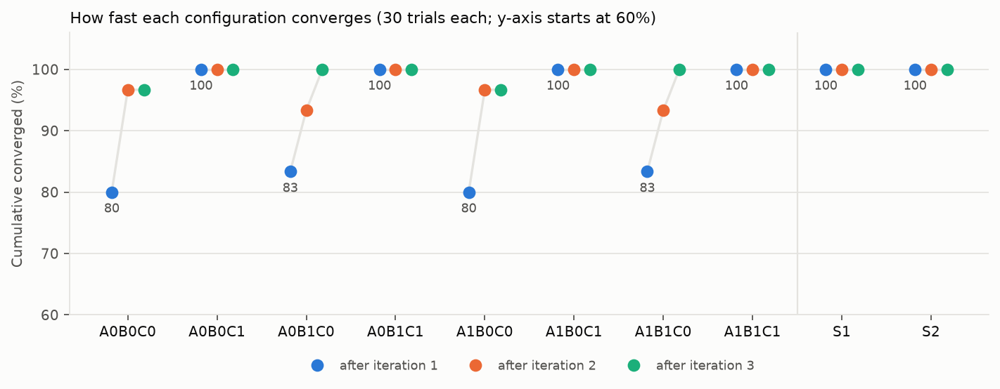
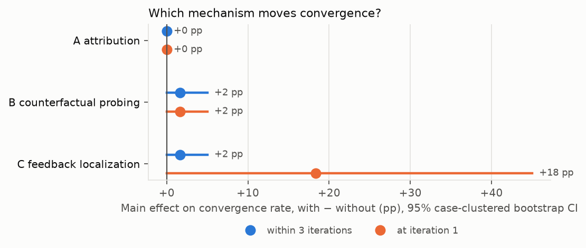

# Task 3: Which Explanation Component Drives Convergence?

Same CVRP instance and the same 10 frozen test cases as Task 2; the three Task 2 components (decision attribution, counterfactual explanation, feedback localization) are switched on and off inside one TPO feedback loop. Everything runs on a laptop CPU (Apple M2 Pro): Gurobi 13.0.3 (size-limited pip license) and `qwen3.8-max` through DashScope's OpenAI-compatible API, `enable_thinking=false`. Full numbers: [`results/formal/task3_results.md`](results/formal/task3_results.md). Design decisions and every deviation: [`DECISIONS.md`](DECISIONS.md).

> **Corrections after the 2026-10 audit** (sections 3 to 5 below report the task3_v1 run as it was; nothing in `results/formal/` was changed):
>
> - **Erratum, condition A (F1).** Task 2's frozen attribution put the alternative plan into canonical form (route with customer 1 = vehicle 1, smaller end first). Under a label- or direction-dependent soft constraint that rewrite changes the objective, so 18 attribution numbers in the prompts were wrong (for example 20,114 for a plan that costs 614 without the anchor, against a current 586), and 15 decisions were called "objective-preferred" although forbidding them was cheaper under v1's own semantics. All of it happened in 2 trials (`A1B0C0`/T2 run 3, `A1B1C0`/T2 run 2), the first of which is one of the run's two failures. Iteration 1 was unaffected (no soft constraints yet), and 278 of 300 trials converged there; but the 11 trials in which A ran at iteration 2 or 3 are the only ones in which A could have mattered. So "A has no measurable effect" does not follow from this run; A was not measured correctly. The task3_v2 batch below repeats the 8 main configurations with the fixed attribution.
> - **task3_v3, the experiment re-designed** (section 9): the v1/v2 test set could not separate the mechanisms (7 of 10 cases solved at iteration 1 by every configuration; the ambiguous cases' limits reached only condition C). v3 has new cases, a simulated user who gives every configuration the same words, and 5 runs. **task3_v3.1** (section 10) repeats it with new seeds, the session's modifications shown in the prompt and three control arms; read the answer to "which mechanism contributes most" there: some of v3's conclusions did not replicate.
> - **Re-check with task2_v2.1** (section 8): four later defects of Task 2's v2 components are fixed in task2_v2.1; re-computed on every state and sample set of the v2 batch, the v2.1 components give exactly what the batch used.
> - **Cost of C (F3).** The token and call counts in section 3 and the claim "it also costs nothing" counted only the TPO requests. Each trial with C (and S2) also needs the shared localization of its (case, run): 195 requests and 301,495 tokens over the 30 localizations. Counted in, `A0B0C1` costs 7.5 requests and 11.8k tokens per trial against 1.23 and 2.0k for `A0B0C0`: C reduces the number of TPO iterations but is about six times more expensive per complaint, not cheaper.
> - The scope of "8 of the 10 complaints are resolved in the first iteration by every configuration" and of the descriptive ranking in section 4 is the task3_v1 batch.

## 1. The TPO loop on this problem

The LLM never edits routes. It edits the **model** (Task 2's modification format: soft constraints, objective weights, data corrections), Gurobi re-solves, and the solver guarantees feasibility. Whether a complaint is gone is decided by Task 2's per-case checker, never by an LLM.

| TPO (paper) | Here |
|---|---|
| Response being optimized | A list of model modifications (at most 4), replacing the previous list each iteration |
| Reward model | No learned RM. (a) After each commit a simulated user answers "resolved / not resolved" (Task 2 checker; threshold never revealed). (b) With B, the counterfactual consequences of each candidate before committing |
| Textual loss | Raw complaint, plus attribution JSON (A) and the structured critique (C), plus the previous attempts and the user's fixed-template feedback |
| Textual gradient and update | The LLM writes the next complete modification list |
| D iterations, N samples | D = 3 (task); N = 3 candidates per iteration when B is on, 1 otherwise |

Commit step: a fresh Gurobi model of instance + case model modifications + proposed list, full solve, Task 2's single anchor (so "vehicle 1" keeps its identity), and routes whose direction does not change the objective are put in Task 2's canonical direction (otherwise arrival-mileage checkers would flip on the solver's arbitrary pick). The prompt sees only public case fields (`id`, `solution`, `complaint`, `model_modifications`); checker, thresholds, reference fix and hand labels stay with the simulated user, and a scan of every prompt confirms it.

## 2. Conditions

| Factor | On | Off |
|---|---|---|
| **A** decision attribution | Decisions named in the complaint (regex on "vehicle k" / "customer i"; if nothing is named, every decision of the current plan, 38 for two 4-customer routes) are attributed on the current plan with Task 2's `attribute()`; the structured result (constraint IDs, variable IDs, objective increase if forbidden, edge differences) goes into the prompt | Raw complaint only |
| **B** counterfactual probing | 3 candidates per iteration, each probed with the counterfactual component (`APPLY_MODIFICATIONS`); an LLM selector sees the predicted consequences and commits one | The single LLM proposal is committed directly |
| **C** feedback localization | Task 2's `localize()` (5 samples, rule-based confidence) once per (case, run). Low confidence triggers one clarifying question, answered by the case's hand-written clarification; still low means stop (counted as not converged). High confidence passes target ID, modification type, confidence and evidence (recomputed every iteration) to TPO | Raw complaint only, no clarification |

All 2³ = 8 combinations were run (so both "full system minus one" and "bare loop plus one" are inside the design), plus two supplementary arms that separate confounds: **S1** = A1B1C1 but the selector does not see the probe results (more samples vs. seeing consequences); **S2** = A1B1C0 plus the user's clarification answer appended to the raw complaint whenever C's shared localization asked for it (structured localization vs. the extra sentence from the user). Each configuration: 3 runs × 10 test cases = 30 trials; 300 trials in total.

## 3. Results

300 trials, 1,105 LLM requests (all succeeded on the first attempt), 4.49M prompt + 0.09M completion tokens, 11 minutes wall time with 4 processes. Protocol frozen before the run ([`protocol.json`](protocol.json): hashes of every Task 3 source and prompt and of the 31 Task 2 files used); acceptance checks all pass ([`results/formal/acceptance.json`](results/formal/acceptance.json)).

| Config | A | B | C | Converged within 3 iterations, mean ± std over 3 runs | Converged at iteration 1 (pooled) | Tokens / trial (TPO only, see F3 above) |
|---|---|---|---|---|---|---|
| A0B0C0 | 0 | 0 | 0 | 96.7% ± 5.8 | 80.0% | 2,020 |
| A1B0C0 | 1 | 0 | 0 | 96.7% ± 5.8 | 80.0% | 8,170 |
| A0B1C0 | 0 | 1 | 0 | 100% ± 0 | 83.3% | 8,729 |
| A1B1C0 | 1 | 1 | 0 | 100% ± 0 | 83.3% | 34,646 |
| A0B0C1 | 0 | 0 | 1 | 100% ± 0 | 100% | 1,778 |
| A1B0C1 | 1 | 0 | 1 | 100% ± 0 | 100% | 6,136 |
| A0B1C1 | 0 | 1 | 1 | 100% ± 0 | 100% | 7,540 |
| A1B1C1 | 1 | 1 | 1 | 100% ± 0 | 100% | 24,996 |
| S1 (blind selection) | 1 | 1 | 1 | 100% ± 0 | 100% | 24,274 |
| S2 (clarification text, no localization) | 1 | 1 | 0 | 100% ± 0 | 100% | 24,192 |



Main effects (4 configurations with the mechanism minus the 4 without, 120 vs 120 trials; 95% CI from a case-clustered bootstrap):

| Mechanism | Within 3 iterations | At iteration 1 |
|---|---|---|
| A attribution | +0.0 pp [+0.0, +0.0] | +0.0 pp [+0.0, +0.0] |
| B counterfactual probing | +1.7 pp [+0.0, +5.0] | +1.7 pp [+0.0, +5.0] |
| C feedback localization | +1.7 pp [+0.0, +5.0] | +18.3 pp [+0.0, +45.0] |



Where the differences come from: 8 of the 10 complaints are resolved in the first iteration by every configuration. All non-first-iteration convergence and both failures are on the two ambiguous complaints, T2 ("Vehicle 1 is doing too much work", meaning load) and T8 ("The drivers are unhappy with how the work is split", meaning load balance). Without C the LLM guesses distance or route length first and needs 2 to 3 iterations; the two failures (A0B0C0 run 1, A1B0C0 run 3, both T2) tried route-length, balance, makespan and load-balance terms but never capped vehicle 1's load itself (`W[1]`), and ended at 94 to 99 units against the 92 the user had in mind. With C, the localizer marks both complaints low-confidence, asks, learns that they are about load (T2: vehicle 1 should carry at most 92 units; T8: the two loads should differ by at most 5), and every configuration resolves them in iteration 1. The third ambiguous complaint, T6 ("one of the numbers you have for customer 7 is wrong, it should be 18"), was also clarified under C, but every configuration resolved it in iteration 1 anyway: the LLM read 18 as the demand without being told. Localization itself: 30/30 shared localizations end high-confidence on the correct target; all 9 ambiguous ones (T2, T6, T8 × 3 runs) asked first, none of the 21 clear ones did.

## 4. Which mechanism contributes most?

> This is the task3_v1 batch's answer. The re-designed experiments changed it; the answer to quote is in section 10.

**By the pre-registered rule, none can be singled out.** The rule needs the top main effect's CI to lie above 0 and to be separated from the runner-up. With a strong LLM, a 9-node instance and 10 cases, the loop is at the ceiling (298 of 300 trials converge, 278 in the first iteration), and every CI touches 0. The same rule applied to first-iteration convergence (the secondary metric fixed in advance for this case) also gives no verdict, because C's +18.3 pp rests on two cases.

**Descriptively, C, through its clarifying question, is the only mechanism that changes anything:**

- It is the only factor with a visible effect on speed (first-iteration convergence 100% vs 80 to 83%), it removes both failures, and its converged plans are the cheapest (exactly the distance of Task 2's reference fix; without C, 3.7 to 9.0 km longer on average). It lowers the TPO calls per trial (1.0 vs 1.23 without B, 4.0 vs 4.93 with B) because no second iteration is needed; with the shared localization counted it is about six times more expensive per complaint (7.5 vs 1.23 requests without B; corrected after the audit, see the note at the top).
- S2 locates the gain: appending the user's clarification sentence to the raw complaint, without the structured target ID and modification type, also reaches 100% in iteration 1. The value is in **asking** when the complaint is ambiguous (which C's confidence gate decides), not in the structured fields.
- A has no measurable effect at all in this batch and multiplies prompt size by about 4. (After the audit: A's numbers were wrong in 2 of the 11 trials where it could matter; see the erratum at the top and the task3_v2 batch.)
- B helps only when C is off (both T2 failures occur without B; with B the same configurations reach 100% by iteration 3), at about 4 times the LLM calls. S1 equals A1B1C1, so there is no evidence that seeing the predicted consequences beats picking blind among the same three candidates.

This should be read as "on clear complaints a capable LLM needs none of the three mechanisms; on ambiguous ones, resolving the ambiguity is what matters", not as evidence that attribution or probing can never help. They may matter with a weaker policy model, a larger instance, or complaints whose fix is not the obvious one.

## 5. Deviations and limitations

1. **The counterfactual probe is not Task 2's frozen local method.** Task 2's local method escalates its neighbourhood only on infeasibility, which soft constraints never cause, so it often returned a stuck L0 that just pays the penalty (for `S[2] ≤ 3` it predicted "nothing changes", 411, while the full solve resolves the complaint at 397). Task 2's own evaluation found the same defect and recommended a new rule version. With the user's approval, Task 3 uses [`tpo/counterfactual_v2.py`](tpo/counterfactual_v2.py): identical except that it also escalates when a query's soft constraint is still violated, when the plan is unchanged, or when the query changes input data. On 205 non-test queries its objective matches the full re-solve in 185/185 cases (frozen version: 168/185), at 71 ms median latency (49 ms frozen); but on this tight instance most modification queries end at L2, so the "local" speed advantage is gone. In the formal run, the committed candidate's probe matched the commit's objective within 1% in 164/164 cases and exactly in 124; the other 40 predicted a plan 1 km longer.
2. Ceiling: see section 4. Ten cases, three runs; a convergence rate moves in steps of 10 points per run.
3. The simulated user answers only through the checker and fixed templates; real users are noisier, change their minds, and complain about valid plans (Task 5).
4. `qwen3.8-max` is an alias without a fixed snapshot (calls on 2026-10-23). The localizer, proposer and selector are the same model.
5. One implementation incident, no effect on results: the first protocol freeze was followed by an import-path bug (Task 2's root also has a `freeze_protocol.py`) that stopped the run at the protocol check before any request; the path order was fixed, a regression test added, and the protocol re-frozen before any trial ran (`protocol_superseded_2026-10-23T1150.json` is kept).

## 6. Reproduce

```bash
cd "Task 3/task3"
export PYTHONDONTWRITEBYTECODE=1
python -m pytest -q                       # 120 tests, no network
python diagnostics/probe_vs_full.py       # frozen vs v2 probe against full re-solve, no LLM
source ~/.dashscope_env                   # DASHSCOPE_API_KEY, DASHSCOPE_BASE_URL (never committed)
python run_experiment.py --cases "../../Task 2/task2/cases/test_cases.json" --configs all --runs 1,2,3 \
       --workers 4 --out results/formal  # refuses unless protocol.json hashes match; resumable
python report.py                          # results/formal/task3_results.{json,md} + figures, offline
python final_checks.py                    # acceptance checklist
```

Task 2 is imported read-only (`tpo/task2_bridge.py`, no bytecode written); the TPO loop core (`tpo/loop.py`: `Trial.step()` is one iteration, `run_trial()` drives up to three against the simulated user) is what the Task 4 service will call once per complaint.

## 7. task3_v2: the same experiment with the fixed attribution (after the audit)

Protocol [`protocol_v2.json`](protocol_v2.json), frozen before any request. The only change is condition A's attribution (Task 2's task2_v2: anchored to the current plan, no relabelling; see `Task 2/task2/README.md` section 8). Loop, prompts, seeds, probe, commit, simulated user and statistics are task3_v1's frozen files. All 8 main configurations were re-run (3 runs x 10 cases = 240 trials) so that A is compared within one batch; S1 and S2 were not re-run (all their trials converged at iteration 1, where the v1 attribution was already correct). The 30 shared localizations are task3_v1's, re-used after checking that Task 2's v2 confidence rule reaches the same decision and question on each of them. 687 requests, all answered on the first attempt by `qwen3.8-max` (2026-10-27, 8 minutes with 4 processes), 2.95M prompt + 0.05M completion tokens. Full report: [`results/formal_v2/task3_v2_results.md`](results/formal_v2/task3_v2_results.md).

| Config | v1: within 3 iterations, mean ± std | v1: at iteration 1 | v2: within 3 iterations, mean ± std | v2: at iteration 1 | v2 requests / tokens per trial, localization included |
|---|---|---|---|---|---|
| A0B0C0 | 96.7% ± 5.8 | 80.0% | 100% ± 0 | 86.7% | 1.13 / 1.8k |
| A1B0C0 | 96.7% ± 5.8 | 80.0% | 90.0% ± 10.0 | 80.0% | 1.37 / 9.8k |
| A0B1C0 | 100% ± 0 | 83.3% | 93.3% ± 5.8 | 83.3% | 4.93 / 8.7k |
| A1B1C0 | 100% ± 0 | 83.3% | 100% ± 0 | 76.7% | 5.47 / 39.4k |
| A0B0C1 | 100% ± 0 | 100% | 100% ± 0 | 100% | 7.5 / 11.8k |
| A1B0C1 | 100% ± 0 | 100% | 100% ± 0 | 100% | 7.5 / 16.2k |
| A0B1C1 | 100% ± 0 | 100% | 100% ± 0 | 100% | 10.5 / 17.6k |
| A1B1C1 | 100% ± 0 | 100% | 100% ± 0 | 100% | 10.5 / 35.0k |

Main effects in the v2 batch (case-clustered bootstrap, 95% CI): A −0.8 pp [−2.5, +0.0] within 3 iterations and −3.3 pp [−8.3, +0.0] at iteration 1; B +0.8 pp [+0.0, +2.5] and −1.7 pp [−4.2, +0.0]; C +4.2 pp [+0.0, +10.8] and +18.3 pp [+0.0, +42.5]. The pre-registered rule again singles out no mechanism, on either metric.

What the v2 batch shows:

- **The attribution numbers are now right.** 510 attribution items reached a prompt at iteration 2 or 3 (13 trials); every number agrees with brute force under the anchor the component used (task3_v1: 18 wrong in 2 of 11 such trials). No decision was reported as `cheaper_without`.
- **Measured correctly, A still does not help.** Its point estimates are slightly negative, `A1B0C0` has 3 failures against 0 for `A0B0C0` (paired McNemar p = 0.25), and A multiplies the TPO tokens by about 3 to 5. The failures look like v1's: without C the LLM tries distance-balance, makespan and load-balance weights for T2 and T8, and never caps vehicle 1's load at the user's limit: one trial capped it at 95 (both vehicles), which the plan meets at 94, and vehicle 1 ends at 94 to 99 units against the user's 92; for T8 the load difference stays at 7 against 5. Knowing why the current plan has its edges does not tell the LLM which quantity the user meant.
- **C is again the only factor with a visible effect**, and all 5 failures of the batch (T2 four times, T8 once) are in configurations without C. With C every trial converges at iteration 1, at the reference fix's distance. It is also the most expensive per complaint (section 3's erratum).
- **Batch-to-batch variation is large even at fixed seeds.** With A off, the iteration-1 prompts of the two batches are byte for byte identical in 120 of 120 trials, yet the LLM's output was identical in only 1 of them; `A0B0C0` moved from 1 failure to 0 and `A0B1C0` from 0 to 2 with nothing changed. This is why the whole design was re-run instead of only the configurations with A, and why the two batches should not be pooled or differenced against each other.
- One committed iteration changed data the user had not meant: in `A1B1C0`/T6 run 1 ("one of the numbers you have for customer 7 is wrong, it should be 18"), without C the LLM read 18 as customer 7's y-coordinate. The plan was infeasible on the real demand, the simulated user said so, and iteration 2 corrected the demand. This is the ambiguity C's question is for.

Reproduce: `python freeze_protocol_v2.py` (refuses if the protocol exists), `python run_experiment_v2.py --workers 4`, `python report_v2.py`; tests `tests/test_v2_components.py`.

## 8. task3_v2.1: the v2 run re-checked with the fixed components (no new run)

After the v2 runs, an independent review found four defects in Task 2's task2_v2 components (Task 2 README 8.4); they are fixed in task2_v2.1 (Task 2 README 8.5). Task 3 did not run again: [`tpo_v21/`](tpo_v21/) is the `tpo_v2` adapter with the v2.1 components, and [`recheck_v21.py`](recheck_v21.py) re-computes them, without the LLM, on every state and sample set the task3_v2 batch recorded, after checking Task 2's `v21/protocol_v21.json`. Result: [`results/recheck_v21/recheck.md`](results/recheck_v21/recheck.md).

| Records of `results/formal_v2` | Checked | v2.1 differs from what the run used |
|---|---:|---:|
| Attribution items, `A1B0C0` | 754 | 0 |
| Attribution items, `A1B0C1` | 498 | 0 |
| Attribution items, `A1B1C0` | 752 | 0 |
| Attribution items, `A1B1C1` | 498 | 0 |
| Shared localizations (first pass and after the clarification) | 39 | 0 |

Every item is compared both as the prompt showed it and in full (conclusion, anchor and its claim, alternative plan and objective, terms). The trial records keep the modifications without the soft-constraint ids the loop assigned at commit (`tpo_<t>_<s>`, `tpo/proposal.py`), and the attribution names objective terms by those ids; the re-check restores them (a first pass without them reported 22 items of `A1B1C0`/T2 run 2 with `soft:balance` for `soft:tpo_1_1`, same values). So the v2 batch in section 7 is also what v2.1 would have produced on the same LLM outputs, and its conclusions stand. Tests: `tests/test_v21_components.py` (3).

## 9. task3_v3: the experiment re-designed (first batch; replicated in section 10)

> Section 10 re-ran this design with new seeds. A's harm and the significance of B's main effect did not replicate; the bullets under "What this shows" are this batch's reading and are kept as written.

Design: [`../../DESIGN_V3.md`](../../DESIGN_V3.md) (written before any LLM call; pilot and its one fix in section 9 there). Protocol [`protocol_v3.json`](protocol_v3.json), frozen before the run. Full report: [`results/formal_v3/task3_v3_results.md`](results/formal_v3/task3_v3_results.md).

**Why a third design.** In task3_v1/v2, 7 of the 10 cases were solved at iteration 1 by every configuration, the limits of the three ambiguous complaints (vehicle 1 at most 92 units, loads within 5) appeared only in the clarification answer that condition C received, and every complaint could be met by one soft constraint at the user's limit, so attribution (A) and the probe (B) had nothing to contribute. "No mechanism can be singled out" was built into the design.

**What changed** (the mechanisms, prompts and seeds did not):

- **Cases** (Task 2's task2_v3, the same 10 for Task 2 and Task 3): 2 control (a clear request), 3 ambiguity (a vague complaint; the most plausible misreading does not resolve it), 5 side (a clear request plus a second condition a dispatcher states that the modification language cannot express directly: "vehicle 1 has left, its route cannot change", "at most two customers may change trucks", "if that is impossible, at least ..., within 370 km", "the earlier fix still holds"). Each property is asserted by brute force when the cases are built; for the side stratum, the direct encoding of the request violates the second condition in every optimum.
- **Simulated user** ([`tpo_v3/user_sim.py`](tpo_v3/user_sim.py)): resolved = feasible on the real data and every stated condition met. Every configuration hears the same words: the explanation (also the clarification answer) the first time a plan misses, and every time the unmet conditions with the plan's values.
- **Loop** ([`tpo_v3/loop.py`](tpo_v3/loop.py), found in the pilot): every iteration starts from the plan complained about, earlier attempts stay in the history. task3_v1 started from the plan just rejected, so "at most two customers may change trucks" was judged against one plan by the user and against another by the prompt, A, B and the commit's anchor.
- **5 runs** per configuration: 8 x 10 x 5 = 400 trials, 50 shared localizations; 1,726 requests, all answered (2026-10-27).

| Config | Within 3 iterations, mean ± std over 5 runs | At iteration 1 | Excess km over the shortest compliant plan (converged) | Requests / tokens per trial (localization incl.) |
|---|---|---|---|---|
| A0B0C0 | 96.0% ± 5.5 | 62% | 5.0 | 1.5 / 2.7k |
| A0B0C1 | 90.0% ± 14.1 | 82% | 3.0 | 8.6 / 14.0k |
| A0B1C0 | **98.0% ± 4.5** | 64% | 3.5 | 5.6 / 10.5k |
| A0B1C1 | 94.0% ± 5.5 | 80% | 2.3 | 12.3 / 22.1k |
| A1B0C0 | 86.0% ± 5.5 | 54% | 3.6 | 1.6 / 12.3k |
| A1B0C1 | 82.0% ± 8.4 | 68% | 4.0 | 8.9 / 23.3k |
| A1B1C0 | 90.0% ± 7.1 | 60% | 2.9 | 6.1 / 47.1k |
| A1B1C1 | 96.0% ± 5.5 | **86%** | 3.2 | 12.0 / 47.7k |

**Pre-registered rule (main effects over all 10 cases, case-clustered bootstrap):** A −6.0 pp [−16.0, 0.0], B +6.0 pp [0.0, +13.0], C −2.0 pp [−8.0, +4.0] within 3 iterations; at iteration 1 A −5.0 [−18.0, +5.0], B +6.0 [−1.0, +14.5], C +19.0 [0.0, +44.0]. The rule singles out no mechanism on either metric (B's interval touches 0).

**Pre-registered strata**, where the cases were built to give each mechanism its chance:

| Stratum | Within 3 iterations, all 8 configs | A | B | C | C at iteration 1 |
|---|---|---|---|---|---|
| control (2) | 100% | 0 | 0 | 0 | 0 |
| ambiguity (3) | 100% | 0 | 0 | 0 | **+61.7 pp [+5.0, +100.0]** |
| side (5) | 64%–96% | **−12.0 pp [−32.0, 0.0]** | **+12.0 pp [+2.0, +22.0]** | −4.0 pp [−16.0, +8.0] | +1.0 pp |

What this shows:

- **B (counterfactual probe) is the mechanism that improves reliable convergence where a fix has side effects.** Side stratum +12 pp, interval above 0; also at iteration 1 (+13 pp [+2, +26]). Taking B out of the full configuration loses 7 trials and gains none (A1B1C1 vs A1B0C1, McNemar p = 0.016). The probe shows, before committing, which customers change trucks and which edges change, so the selector can drop a candidate that breaks "at most two customers" or "vehicle 1 keeps its route". This holds although the probe is the local method the task requires and is itself imperfect (Task 2 v3: objective within 1% on 25/28 queries, change set right on 20/28).
- **C (localization with its question) saves an iteration on vague complaints, nothing more.** On the ambiguity stratum every configuration converges within 3 iterations, because the user explains after a failed plan; C asks first and converges at iteration 1 (+61.7 pp). On side cases C does not help: the localizer is unsure about complaints that state two conditions (9 of the 25 side localizations asked a question; one of them, U9 run 5, stayed low after the answer and stopped that trial in all four C configurations).
- **A (decision attribution) did not help; on side cases it hurt (−12 pp).** Two causes in the trials: in U10 the attribution of SAME(4,5) shows the session's earlier fix as `soft:same[4,5]: 100`, and with A the LLM re-added that constraint in 84% of its proposals (50% without A), spending one of its 4 allowed modifications, so vehicle 2's route could not be pinned (U10 converged in 8 of 20 trials with A, 18 of 20 without). In U8 the A configurations kept trying to put all four south-western customers on one truck: pairwise attribution does not say that a group of four does not fit. The A prompt is also about 14 times longer (20.6k against 1.4k characters in U10).
- **Answer to the task's question, on this evidence:** B contributes most to reliable convergence, and only where a fix has consequences the LLM cannot foresee; C contributes speed on ambiguous complaints; A does not contribute. Overall rates differ little because two of the three strata are at 100% for every configuration by design (fair information); the pre-registered overall rule therefore stays undetermined, and the stratum results are the informative ones.

**Two weaknesses of this design, found in the results and not fixed after the fact:** (1) soft constraints that were already in force in the session (U9: road 4–7 closed; U10: 4 and 5 together) are not shown in the prompt (task3_v1's cases only had data corrections, which the instance table shows), which is what made re-adding them costly in U10; (2) the 4-modification cap interacts with it. A v3.1 that shows the session's constraints would test whether A's harm survives; it would be a new pre-registered batch, not a change to this one.

Reproduce: `python run_experiment_v3.py --configs A0B0C0,A1B1C1 --runs 1,2 --out results/pilot_v3b` (dev pilot), `python freeze_protocol_v3.py`, `python run_experiment_v3.py --cases test --configs main --runs 1,2,3,4,5 --out results/formal_v3 --workers 4`, `python report_v3.py --out results/formal_v3`; tests `tests/test_v3.py`.

## 10. task3_v3.1: the v3 design repeated, with three control arms (the result to quote)

Design: [`../../DESIGN_V31.md`](../../DESIGN_V31.md) (written before any LLM call; pilot, an API outage and its handling in section 8, results in section 9 there). Protocol [`protocol_v31.json`](protocol_v31.json), frozen before the run. Full report: [`results/formal_v31/task3_v31_results.md`](results/formal_v31/task3_v31_results.md). The v3 batch in section 9 is kept as it was.

**Why.** Two gaps in v3: (1) the soft constraints already in force in a session (U9, U10) were in the solver's model but not in the prompt ("Modifications currently in force: none"), which looked like the cause of A's harm; (2) switching B on changed two things at once, from 1 candidate to 3 and from no probe to a probe, so v3 could not say whether B's gain came from seeing consequences (what the task means by condition B) or from sampling more. v1 had a blind-selection arm; v3 had left it out.

**What changed:**

- **Loop** ([`tpo_v31/loop.py`](tpo_v31/loop.py)): a block "Modifications set earlier in this session (kept in force)" lists the session's modifications, worded like Task 4's block for accepted modifications. The prompts of U1-U8 are byte-identical to v3's (tested). Task 4 shows the same block (`feedback_service_v31/`, section 13 of Task 4's README).
- **Control arms:** `S1a` = `A0B1C0` and `S1b` = `A1B1C1` with blind selection (the same 3 candidates and selector, no probe); `S2a` = `A0B0C0` plus the user's clarification answer as text whenever the shared localization asked (no structured localization).
- **Runs 6-10**, so every seed differs from v3's runs 1-5, and 50 new shared localizations. 11 x 10 x 5 = 550 trials.
- **API outage:** from 16:13 DashScope refused every request (403 `AccessDenied.Unpurchased`, an account issue) while the last arms ran. Every trial with a refused request (116, all in `S1a`/`S1b`/`S2a`, whatever its outcome) was moved unchanged to `results/formal_v31/invalid_api_403/` and re-run with the same seeds once access was back. The 8 main configurations and the localizations had finished before and contain no refused request. Final batch: 550 trials, 2,522 answered requests (all `qwen3.8-max`), no refused request in any trial used.

| Config | Within 3 iterations, mean ± std over 5 runs | At iteration 1 | Requests / tokens per trial (localization incl.) |
|---|---|---|---|
| A0B0C0 | 96.0% ± 5.5 | 60% | 1.6 / 2.9k |
| A0B0C1 | 82.0% ± 10.9 | 68% | 9.2 / 15.1k |
| A0B1C0 | 94.0% ± 5.5 | 64% | 5.8 / 11.2k |
| A0B1C1 | 86.0% ± 5.5 | 66% | 13.2 / 24.3k |
| A1B0C0 | **98.0% ± 4.5** | 60% | 1.5 / 11.1k |
| A1B0C1 | 82.0% ± 13.0 | 70% | 9.1 / 22.4k |
| A1B1C0 | **98.0% ± 4.5** | 58% | 6.0 / 45.6k |
| A1B1C1 | 90.0% ± 7.1 | 68% | 12.9 / 51.6k |
| S1a (A0B1C0, blind) | 86.0% ± 5.5 | 54% | 6.5 / 11.8k |
| S1b (A1B1C1, blind) | 80.0% ± 12.2 | 62% | 13.6 / 55.8k |
| S2a (A0B0C0 + answer) | 88.0% ± 8.4 | 74% | 9.2 / 15.0k |

**Pre-registered main analysis** (8 main configurations): A +2.5 pp [−0.5, +6.5], B +2.5 pp [−3.0, +8.5], C −11.5 pp [−25.5, 0.0]; no mechanism singled out, also at iteration 1. **Strata:** control and ambiguity 100% for every main configuration (as in v3); side: A +5 [−1, +11], B +5 [−6, +17], C −23 [−43, −3]; at iteration 1, C +60 [0, +100] on ambiguity (v3 +61.7) and −21 [−35, −7] on side.

**The three pre-registered questions:**

1. **A's harm (v3: −12 pp on side cases) did not replicate, and not because of the change.** By the pre-registered reading, no harm is detectable (side +5 [−1, +11]). But showing the session's modifications did not reduce re-writing them (U10: 62% of valid proposals, v3 65%; U9: 90%, v3 93%). Which side of A re-wrote more simply swapped (U10 without/with A: v3 40% / 80%, v3.1 83% / 38%), and convergence swapped with it (v3 18/20 vs 8/20, v3.1 12/20 vs 15/20). U8 has no session modification and byte-identical prompts, yet A's direction also flipped (v3 16 vs 14, v3.1 16 vs 18). v3's A effect was most likely sampling variation; A has no reliable effect in either batch.
2. **Where B's gain comes from: seeing consequences, not more candidates, but the pre-registered reading lands on its boundary.** With the same 3 candidates, choosing with the probe's forecast beats choosing blind: pooled +9.0 pp [0.0, +20.0] (discordant pairs 11 vs 2, McNemar p = 0.023), side cases +18 [+2, +34]. Choosing blind among 3 is worse than taking a single candidate: pooled −6 [−13, 0], side −12 [−22, −2]. The pre-registered rule needs the pooled lower bound above 0; it is exactly 0, so the verdict is "cannot be separated". Every direction points the same way: the probe is what helps, and more candidates without it hurt.
3. **C's gain on vague complaints comes from asking, not from the structure.** At iteration 1 on ambiguity cases `A0B0C1` and `S2a` (the user's answer as plain text, no target ID or modification type) both reach 100%, `A0B0C0` 47%. C's loss on side cases comes from its gate: U9's localization was still unsure after the question in 3 of 5 runs (1 of 5 in v3), and all four C configurations stop there. `S2a`, without the gate, reaches 88% within 3 iterations against 82% for `A0B0C1`.

**Answer to the task's question across both batches.** On this instance the bare loop already converges in 96% of trials within 3 iterations (both batches), because the simulated user explains after a failed plan; the mechanisms have little room. What contributes most to reliable convergence is B's counterfactual probe, with moderate evidence: B's main effect on side cases is positive in both batches (+12, significant; +5, not), and with identical candidates the forecast beats blind choice (+18 [+2, +34] on side cases); the pre-registered overall rules stay undetermined in both batches. Taken alone, v3.1 does not single out B: over all cases A and B have the same main effect (+2.5 pp each), and its best configurations (98%) are `A1B0C0` and `A1B1C0`, one trial above `A0B0C0`. The case for B rests on its consistent direction across batches and on the probe-versus-blind contrast, whose pooled interval touches 0. C's value is the clarifying question (one iteration saved on vague complaints), and its stop-when-still-unsure gate costs reliability. A contributes nothing reliable. Replication on U1-U8, where the v3 and v3.1 prompts are identical (converged of 40, v3 / v3.1): A0B0C0 39/38, A0B0C1 36/37, A0B1C0 39/38, A0B1C1 39/40, A1B0C0 36/40, A1B0C1 36/36, A1B1C0 39/40, A1B1C1 40/40.

Reproduce: `python run_experiment_v31.py --cases dev --case-ids P10,P3,P6 --configs all --runs 6 --out results/pilot_v31` (dev pilot), `python freeze_protocol_v31.py`, `python run_experiment_v31.py --cases test --configs all --out results/formal_v31`, `python report_v31.py --out results/formal_v31`; tests `tests/test_v31.py`.

