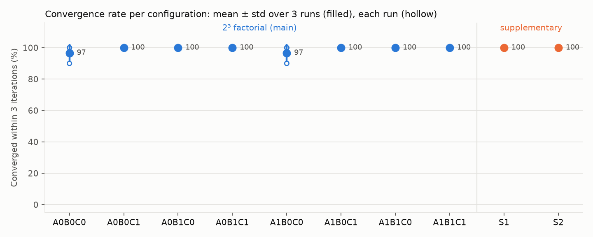

# Task 3 results

Protocol `protocol.json` frozen 2026-10-23T11:51:28+08:00 (sha256 of test cases `43b31ce63a55…`, Task 2 protocol `dd0b13230f90…`). LLM `qwen3.8-max` (alias, no fixed snapshot), requests 2026-10-23T11:51:33+08:00 to 2026-10-23T12:02:13+08:00: 1105 requests, 4,485,315 prompt + 90,623 completion tokens. 300 trials = 10 configurations × 3 runs × 10 test cases.

## 1. Convergence rate per configuration

Converged = feasible and complaint-free (Task 2 checker) within 3 TPO iterations. Mean and sample std over 3 runs of the 10-case rate.

| Config | A | B | C | Mean ± std | Runs | Pooled (95% Wilson) | Cum. at t=1/2/3 | All 3 runs | Low-conf. stops | LLM calls / trial | Tokens / trial |
|---|---|---|---|---|---|---|---|---|---|---|---|
| A0B0C0 | 0 | 0 | 0 | 96.7% ± 5.8 | 90.0% / 100.0% / 100.0% | 96.7% [83.3%, 99.4%] | 80.0% / 96.7% / 96.7% | 9/10 | 0 | 1.23 | 2,020 |
| A0B0C1 | 0 | 0 | 1 | 100.0% ± 0.0 | 100.0% / 100.0% / 100.0% | 100.0% [88.6%, 100.0%] | 100.0% / 100.0% / 100.0% | 10/10 | 0 | 1 | 1,778 |
| A0B1C0 | 0 | 1 | 0 | 100.0% ± 0.0 | 100.0% / 100.0% / 100.0% | 100.0% [88.6%, 100.0%] | 83.3% / 93.3% / 100.0% | 10/10 | 0 | 4.93 | 8,729 |
| A0B1C1 | 0 | 1 | 1 | 100.0% ± 0.0 | 100.0% / 100.0% / 100.0% | 100.0% [88.6%, 100.0%] | 100.0% / 100.0% / 100.0% | 10/10 | 0 | 4 | 7,540 |
| A1B0C0 | 1 | 0 | 0 | 96.7% ± 5.8 | 100.0% / 100.0% / 90.0% | 96.7% [83.3%, 99.4%] | 80.0% / 96.7% / 96.7% | 9/10 | 0 | 1.23 | 8,170 |
| A1B0C1 | 1 | 0 | 1 | 100.0% ± 0.0 | 100.0% / 100.0% / 100.0% | 100.0% [88.6%, 100.0%] | 100.0% / 100.0% / 100.0% | 10/10 | 0 | 1 | 6,136 |
| A1B1C0 | 1 | 1 | 0 | 100.0% ± 0.0 | 100.0% / 100.0% / 100.0% | 100.0% [88.6%, 100.0%] | 83.3% / 93.3% / 100.0% | 10/10 | 0 | 4.93 | 34,646 |
| A1B1C1 | 1 | 1 | 1 | 100.0% ± 0.0 | 100.0% / 100.0% / 100.0% | 100.0% [88.6%, 100.0%] | 100.0% / 100.0% / 100.0% | 10/10 | 0 | 4 | 24,996 |
| S1 | 1 | 1 blind | 1 | 100.0% ± 0.0 | 100.0% / 100.0% / 100.0% | 100.0% [88.6%, 100.0%] | 100.0% / 100.0% / 100.0% | 10/10 | 0 | 4 | 24,274 |
| S2 | 1 | 1 | 0 +clar. text | 100.0% ± 0.0 | 100.0% / 100.0% / 100.0% | 100.0% [88.6%, 100.0%] | 100.0% / 100.0% / 100.0% | 10/10 | 0 | 4 | 24,192 |

## 2. Mechanism effects

Main effect = rate of the 4 factorial configurations with the mechanism minus the 4 without (120 vs 120 trials). Interaction = effect of the first factor with the second on, minus with it off. 95% CI: case-clustered bootstrap, 10,000 resamples, seed 42.

| Effect | Within 3 iterations | 95% CI | At iteration 1 (secondary) | 95% CI |
|---|---|---|---|---|
| main_A | +0.0 pp | [+0.0, +0.0] | +0.0 pp | [+0.0, +0.0] |
| main_B | +1.7 pp | [+0.0, +5.0] | +1.7 pp | [+0.0, +5.0] |
| main_C | +1.7 pp | [+0.0, +5.0] | +18.3 pp | [+0.0, +45.0] |
| interaction_AB | +0.0 pp | [+0.0, +0.0] | +0.0 pp | [+0.0, +0.0] |
| interaction_AC | +0.0 pp | [+0.0, +0.0] | +0.0 pp | [+0.0, +0.0] |
| interaction_BC | -3.3 pp | [-10.0, +0.0] | -3.3 pp | [-10.0, +0.0] |

**Pre-registered rule (primary):** At 10 cases and 3 runs per configuration, no mechanism can be singled out.  
**Same rule on convergence at iteration 1 (secondary):** At 10 cases and 3 runs per configuration, no mechanism can be singled out.

### Paired comparisons (exact McNemar over (case, run) pairs)

| Slice | Comparison | Pairs | Only first converged | Only second converged | p |
|---|---|---|---|---|---|
| full_minus | A1B1C1 vs A0B1C1 | 30 | 0 | 0 | 1.0 |
| full_minus | A1B1C1 vs A1B0C1 | 30 | 0 | 0 | 1.0 |
| full_minus | A1B1C1 vs A1B1C0 | 30 | 0 | 0 | 1.0 |
| bare_plus | A1B0C0 vs A0B0C0 | 30 | 1 | 1 | 1.0 |
| bare_plus | A0B1C0 vs A0B0C0 | 30 | 1 | 0 | 1.0 |
| bare_plus | A0B0C1 vs A0B0C0 | 30 | 1 | 0 | 1.0 |
| supplementary | A1B1C1 vs S1 | 30 | 0 | 0 | 1.0 |
| supplementary | S1 vs A1B0C1 | 30 | 0 | 0 | 1.0 |
| supplementary | A1B1C1 vs S2 | 30 | 0 | 0 | 1.0 |
| supplementary | S2 vs A1B1C0 | 30 | 0 | 0 | 1.0 |

## 3. Per case (converged runs out of 3)

| Case | Clarity | Object | A0B0C0 | A0B0C1 | A0B1C0 | A0B1C1 | A1B0C0 | A1B0C1 | A1B1C0 | A1B1C1 | S1 | S2 |
|---|---|---|---|---|---|---|---|---|---|---|---|---|
| T1 | clear | vehicle | 3 | 3 | 3 | 3 | 3 | 3 | 3 | 3 | 3 | 3 |
| T2 | ambiguous | vehicle | 2 | 3 | 3 | 3 | 2 | 3 | 3 | 3 | 3 | 3 |
| T3 | clear | customer | 3 | 3 | 3 | 3 | 3 | 3 | 3 | 3 | 3 | 3 |
| T4 | clear | customer | 3 | 3 | 3 | 3 | 3 | 3 | 3 | 3 | 3 | 3 |
| T5 | clear | data | 3 | 3 | 3 | 3 | 3 | 3 | 3 | 3 | 3 | 3 |
| T6 | ambiguous | data | 3 | 3 | 3 | 3 | 3 | 3 | 3 | 3 | 3 | 3 |
| T7 | clear | global | 3 | 3 | 3 | 3 | 3 | 3 | 3 | 3 | 3 | 3 |
| T8 | ambiguous | global | 3 | 3 | 3 | 3 | 3 | 3 | 3 | 3 | 3 | 3 |
| T9 | clear | customer | 3 | 3 | 3 | 3 | 3 | 3 | 3 | 3 | 3 | 3 |
| T10 | clear | customer | 3 | 3 | 3 | 3 | 3 | 3 | 3 | 3 | 3 | 3 |

By clarity: A0B0C0: {'ambiguous': '8/9', 'clear': '21/21'}; A0B0C1: {'ambiguous': '9/9', 'clear': '21/21'}; A1B1C0: {'ambiguous': '9/9', 'clear': '21/21'}; A1B1C1: {'ambiguous': '9/9', 'clear': '21/21'}

## 4. Diagnostics

- Shared localization (30 = 10 cases × 3 runs, Task 2's frozen localizer, run labels t3-1..3): clarification asked 9×; final high-confidence and correct 30, high-confidence but wrong target 0, still low after clarification 0. Expected vs first-pass confidence: {'expected high / first high': 21, 'expected low / first low': 9}.
- Probe (Task 3's v2 local counterfactual) vs commit (full re-solve) on the 164 committed, probed candidates: feasibility and objective within 1% agree in all; objective exactly equal in 124; the other 40 predict a plan longer by [1] km (the local search stopped at L0/L1 once the soft constraint was met), so their change sets differ.
- A0B1C0: probe vs commit agreement {'feasible': 1.0, 'objective_1pct': 1.0, 'change_set': 0.8108}
- A0B1C1: probe vs commit agreement {'feasible': 1.0, 'objective_1pct': 1.0, 'change_set': 0.7}
- A1B1C0: probe vs commit agreement {'feasible': 1.0, 'objective_1pct': 1.0, 'change_set': 0.8378}
- A1B1C1: probe vs commit agreement {'feasible': 1.0, 'objective_1pct': 1.0, 'change_set': 0.7}
- S2: probe vs commit agreement {'feasible': 1.0, 'objective_1pct': 1.0, 'change_set': 0.7}
- A0B0C0: invalid candidates 0.0%, rejected iterations 0, no-plan iterations 0, illegal data modifications 0, selector failures 0, mean iterations when converged 1.1724, excess distance vs Task 2 reference fix 7.55, converged with ties not all resolving 0, converged trials whose checker names a vehicle (verdict would flip if the labels were swapped) 5
- A0B0C1: invalid candidates 0.0%, rejected iterations 0, no-plan iterations 0, illegal data modifications 0, selector failures 0, mean iterations when converged 1, excess distance vs Task 2 reference fix 0, converged with ties not all resolving 0, converged trials whose checker names a vehicle (verdict would flip if the labels were swapped) 6
- A0B1C0: invalid candidates 0.0%, rejected iterations 0, no-plan iterations 0, illegal data modifications 0, selector failures 0, mean iterations when converged 1.2333, excess distance vs Task 2 reference fix 3.73, converged with ties not all resolving 0, converged trials whose checker names a vehicle (verdict would flip if the labels were swapped) 6
- A0B1C1: invalid candidates 0.0%, rejected iterations 0, no-plan iterations 0, illegal data modifications 0, selector failures 0, mean iterations when converged 1, excess distance vs Task 2 reference fix 0, converged with ties not all resolving 0, converged trials whose checker names a vehicle (verdict would flip if the labels were swapped) 6
- A1B0C0: invalid candidates 0.0%, rejected iterations 0, no-plan iterations 0, illegal data modifications 0, selector failures 0, mean iterations when converged 1.1724, excess distance vs Task 2 reference fix 8.97, converged with ties not all resolving 0, converged trials whose checker names a vehicle (verdict would flip if the labels were swapped) 5
- A1B0C1: invalid candidates 0.0%, rejected iterations 0, no-plan iterations 0, illegal data modifications 0, selector failures 0, mean iterations when converged 1, excess distance vs Task 2 reference fix 0, converged with ties not all resolving 0, converged trials whose checker names a vehicle (verdict would flip if the labels were swapped) 6
- A1B1C0: invalid candidates 0.0%, rejected iterations 0, no-plan iterations 0, illegal data modifications 0, selector failures 0, mean iterations when converged 1.2333, excess distance vs Task 2 reference fix 8.93, converged with ties not all resolving 0, converged trials whose checker names a vehicle (verdict would flip if the labels were swapped) 6
- A1B1C1: invalid candidates 0.0%, rejected iterations 0, no-plan iterations 0, illegal data modifications 0, selector failures 0, mean iterations when converged 1, excess distance vs Task 2 reference fix 0, converged with ties not all resolving 0, converged trials whose checker names a vehicle (verdict would flip if the labels were swapped) 6
- S1: invalid candidates 0.0%, rejected iterations 0, no-plan iterations 0, illegal data modifications 0, selector failures 0, mean iterations when converged 1, excess distance vs Task 2 reference fix 0, converged with ties not all resolving 0, converged trials whose checker names a vehicle (verdict would flip if the labels were swapped) 6
- S2: invalid candidates 0.0%, rejected iterations 0, no-plan iterations 0, illegal data modifications 0, selector failures 0, mean iterations when converged 1, excess distance vs Task 2 reference fix 0, converged with ties not all resolving 0, converged trials whose checker names a vehicle (verdict would flip if the labels were swapped) 6
