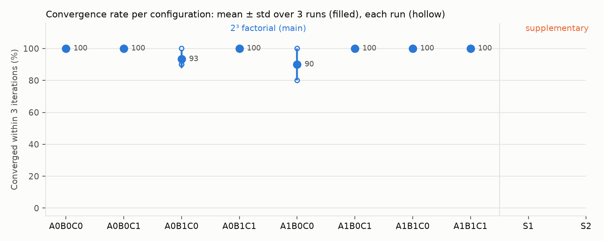
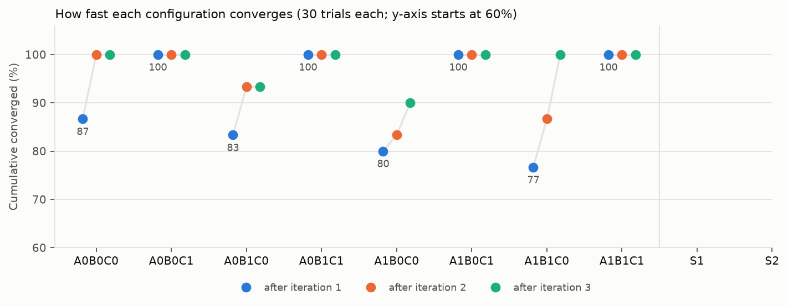

# Task 3 results, protocol task3_v2

Protocol `protocol_v2.json` frozen 2026-10-27T00:07:58+08:00. Change against task3_v1: condition A uses Task 2's task2_v2 attribution (audit F1). Everything else is task3_v1's frozen loop, prompts and seeds. 240 trials = 8 configurations x 3 runs x 10 test cases; S1 and S2 were not re-run. The 30 shared localizations are task3_v1's, re-used after checking that the v2 confidence rule reaches the same decision and question on their samples.

## 1. Convergence, v1 and v2 batches

| Config | v1 mean ± std | v1 runs | v1 at t=1 | v1 failures | v2 mean ± std | v2 runs | v2 at t=1 | v2 failures |
|---|---|---|---|---|---|---|---|---|
| A0B0C0 | 96.7% ± 5.8 | 90.0% / 100.0% / 100.0% | 80.0% | 1 | 100.0% ± 0.0 | 100.0% / 100.0% / 100.0% | 86.7% | 0 |
| A0B0C1 | 100.0% ± 0.0 | 100.0% / 100.0% / 100.0% | 100.0% | 0 | 100.0% ± 0.0 | 100.0% / 100.0% / 100.0% | 100.0% | 0 |
| A0B1C0 | 100.0% ± 0.0 | 100.0% / 100.0% / 100.0% | 83.3% | 0 | 93.3% ± 5.8 | 100.0% / 90.0% / 90.0% | 83.3% | 2 |
| A0B1C1 | 100.0% ± 0.0 | 100.0% / 100.0% / 100.0% | 100.0% | 0 | 100.0% ± 0.0 | 100.0% / 100.0% / 100.0% | 100.0% | 0 |
| A1B0C0 | 96.7% ± 5.8 | 100.0% / 100.0% / 90.0% | 80.0% | 1 | 90.0% ± 10.0 | 80.0% / 100.0% / 90.0% | 80.0% | 3 |
| A1B0C1 | 100.0% ± 0.0 | 100.0% / 100.0% / 100.0% | 100.0% | 0 | 100.0% ± 0.0 | 100.0% / 100.0% / 100.0% | 100.0% | 0 |
| A1B1C0 | 100.0% ± 0.0 | 100.0% / 100.0% / 100.0% | 83.3% | 0 | 100.0% ± 0.0 | 100.0% / 100.0% / 100.0% | 76.7% | 0 |
| A1B1C1 | 100.0% ± 0.0 | 100.0% / 100.0% / 100.0% | 100.0% | 0 | 100.0% ± 0.0 | 100.0% / 100.0% / 100.0% | 100.0% | 0 |

## 2. Mechanism effects (v2 batch; v1 for reference)

| Effect | v2 within 3 iterations [95% CI] | v2 at iteration 1 [95% CI] | v1 within 3 iterations | v1 at iteration 1 |
|---|---|---|---|---|
| main_A | -0.8 pp [-2.5, +0.0] | -3.3 pp [-8.3, +0.0] | +0.0 pp | +0.0 pp |
| main_B | +0.8 pp [+0.0, +2.5] | -1.7 pp [-4.2, +0.0] | +1.7 pp | +1.7 pp |
| main_C | +4.2 pp [+0.0, +10.8] | +18.3 pp [+0.0, +42.5] | +1.7 pp | +18.3 pp |
| interaction_AB | +8.3 pp [+0.0, +21.7] | +0.0 pp [-5.0, +5.0] | +0.0 pp | +0.0 pp |
| interaction_AC | +1.7 pp [+0.0, +5.0] | +6.7 pp [+0.0, +16.7] | +0.0 pp | +0.0 pp |
| interaction_BC | -1.7 pp [-5.0, +0.0] | +3.3 pp [+0.0, +8.3] | -3.3 pp | -3.3 pp |

**Pre-registered rule, v2 (primary):** At 10 cases and 3 runs per configuration, no mechanism can be singled out.  
**Same rule on convergence at iteration 1, v2 (secondary):** At 10 cases and 3 runs per configuration, no mechanism can be singled out.

### Paired comparisons in the v2 batch (exact McNemar over (case, run) pairs)

| Slice | Comparison | Pairs | Only first converged | Only second converged | p |
|---|---|---|---|---|---|
| full_minus | A1B1C1 vs A0B1C1 | 30 | 0 | 0 | 1.0 |
| full_minus | A1B1C1 vs A1B0C1 | 30 | 0 | 0 | 1.0 |
| full_minus | A1B1C1 vs A1B1C0 | 30 | 0 | 0 | 1.0 |
| bare_plus | A1B0C0 vs A0B0C0 | 30 | 0 | 3 | 0.25 |
| bare_plus | A0B1C0 vs A0B0C0 | 30 | 0 | 2 | 0.5 |
| bare_plus | A0B0C1 vs A0B0C0 | 30 | 0 | 0 | 1.0 |

## 3. Per case (converged runs out of 3), v1 / v2

| Case | A0B0C0 | A0B0C1 | A0B1C0 | A0B1C1 | A1B0C0 | A1B0C1 | A1B1C0 | A1B1C1 |
|---|---|---|---|---|---|---|---|---|
| T1 | 3 / 3 | 3 / 3 | 3 / 3 | 3 / 3 | 3 / 3 | 3 / 3 | 3 / 3 | 3 / 3 |
| T2 | 2 / 3 | 3 / 3 | 3 / 1 | 3 / 3 | 2 / 1 | 3 / 3 | 3 / 3 | 3 / 3 |
| T3 | 3 / 3 | 3 / 3 | 3 / 3 | 3 / 3 | 3 / 3 | 3 / 3 | 3 / 3 | 3 / 3 |
| T4 | 3 / 3 | 3 / 3 | 3 / 3 | 3 / 3 | 3 / 3 | 3 / 3 | 3 / 3 | 3 / 3 |
| T5 | 3 / 3 | 3 / 3 | 3 / 3 | 3 / 3 | 3 / 3 | 3 / 3 | 3 / 3 | 3 / 3 |
| T6 | 3 / 3 | 3 / 3 | 3 / 3 | 3 / 3 | 3 / 3 | 3 / 3 | 3 / 3 | 3 / 3 |
| T7 | 3 / 3 | 3 / 3 | 3 / 3 | 3 / 3 | 3 / 3 | 3 / 3 | 3 / 3 | 3 / 3 |
| T8 | 3 / 3 | 3 / 3 | 3 / 3 | 3 / 3 | 3 / 2 | 3 / 3 | 3 / 3 | 3 / 3 |
| T9 | 3 / 3 | 3 / 3 | 3 / 3 | 3 / 3 | 3 / 3 | 3 / 3 | 3 / 3 | 3 / 3 |
| T10 | 3 / 3 | 3 / 3 | 3 / 3 | 3 / 3 | 3 / 3 | 3 / 3 | 3 / 3 | 3 / 3 |

## 4. Attribution in the prompt (the reason for v2)

- Attribution items shown at iteration 2 or 3 in the v2 batch: 510 in 13 trials. Numbers that disagree with brute force under the anchor the component used: 0 (task3_v1: 18 in 2 of 11 such trials). Conclusions `cheaper_without`: 0.

## 5. Cost per trial, shared localization included (audit F3)

task3_v1's README counted only the TPO calls, so configurations with C looked cheapest. Each trial with C (and S2) also needs the shared localization of its (case, run): 5 samples, plus 5 more after a clarification. Its cost is taken from task3_v1's logs for both batches, because v2 re-used those localizations.

| Config | v1 TPO calls | v1 total calls | v1 total tokens | v2 TPO calls | v2 total calls | v2 total tokens |
|---|---|---|---|---|---|---|
| A0B0C0 | 1.23 | 1.23 | 2,020 | 1.13 | 1.13 | 1,824 |
| A0B0C1 | 1 | 7.5 | 11,828 | 1 | 7.5 | 11,826 |
| A0B1C0 | 4.93 | 4.93 | 8,729 | 4.93 | 4.93 | 8,679 |
| A0B1C1 | 4 | 10.5 | 17,590 | 4 | 10.5 | 17,590 |
| A1B0C0 | 1.23 | 1.23 | 8,170 | 1.37 | 1.37 | 9,785 |
| A1B0C1 | 1 | 7.5 | 16,186 | 1 | 7.5 | 16,173 |
| A1B1C0 | 4.93 | 4.93 | 34,646 | 5.47 | 5.47 | 39,368 |
| A1B1C1 | 4 | 10.5 | 35,046 | 4 | 10.5 | 34,978 |
| S1 | 4 | 10.5 | 34,324 | not re-run | | |
| S2 | 4 | 10.5 | 34,242 | not re-run | | |

## 6. Shared localization (v2 batch)

- 30 localizations: asked 9x; final high-confidence and correct 30, high-confidence but wrong 0, still low 0.
- A0B0C0: invalid candidates 0.0%, rejected iterations 0, no-plan iterations 0, illegal data modifications 0, mean iterations when converged 1.1333, excess distance vs Task 2 reference fix 11.4, probe vs commit None
- A0B0C1: invalid candidates 0.0%, rejected iterations 0, no-plan iterations 0, illegal data modifications 0, mean iterations when converged 1, excess distance vs Task 2 reference fix 0, probe vs commit None
- A0B1C0: invalid candidates 0.9%, rejected iterations 0, no-plan iterations 0, illegal data modifications 0, mean iterations when converged 1.1071, excess distance vs Task 2 reference fix 5.64, probe vs commit {'feasible': 1.0, 'objective_1pct': 1.0, 'change_set': 0.8378}
- A0B1C1: invalid candidates 0.0%, rejected iterations 0, no-plan iterations 0, illegal data modifications 0, mean iterations when converged 1, excess distance vs Task 2 reference fix 0, probe vs commit {'feasible': 1.0, 'objective_1pct': 1.0, 'change_set': 0.7}
- A1B0C0: invalid candidates 0.0%, rejected iterations 0, no-plan iterations 0, illegal data modifications 0, mean iterations when converged 1.1852, excess distance vs Task 2 reference fix 2.44, probe vs commit None
- A1B0C1: invalid candidates 0.0%, rejected iterations 0, no-plan iterations 0, illegal data modifications 0, mean iterations when converged 1, excess distance vs Task 2 reference fix 0, probe vs commit None
- A1B1C0: invalid candidates 0.0%, rejected iterations 0, no-plan iterations 0, illegal data modifications 1, mean iterations when converged 1.3667, excess distance vs Task 2 reference fix 7.93, probe vs commit {'feasible': 1.0, 'objective_1pct': 1.0, 'change_set': 0.8537}
- A1B1C1: invalid candidates 0.0%, rejected iterations 0, no-plan iterations 0, illegal data modifications 0, mean iterations when converged 1, excess distance vs Task 2 reference fix 0, probe vs commit {'feasible': 1.0, 'objective_1pct': 1.0, 'change_set': 0.7}
